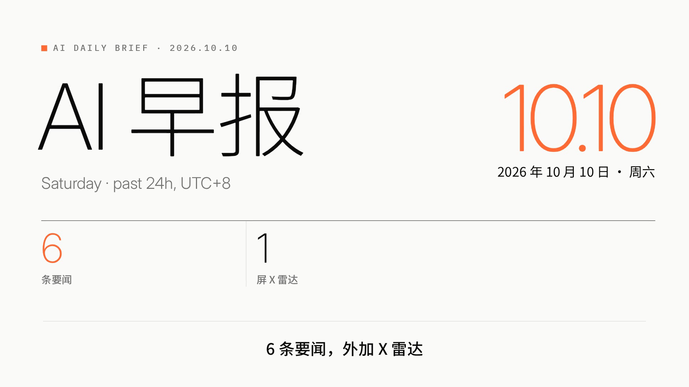
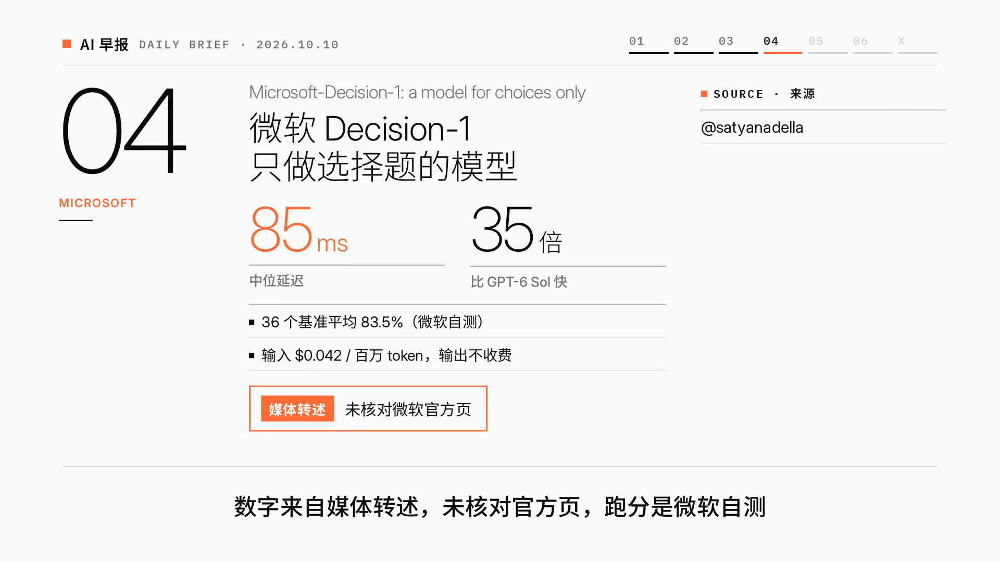
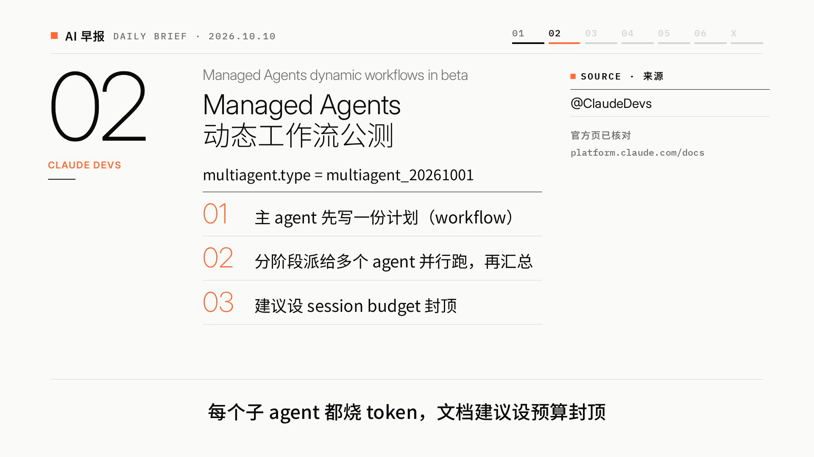
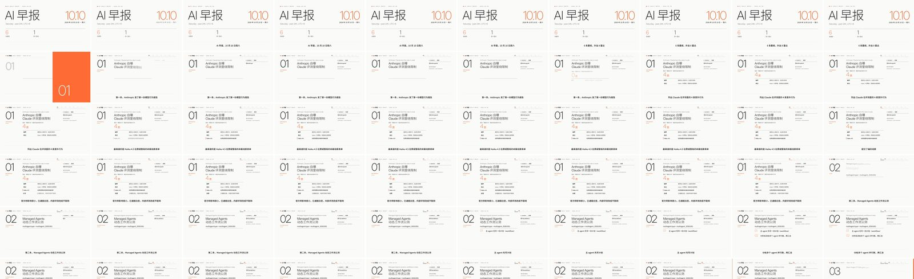
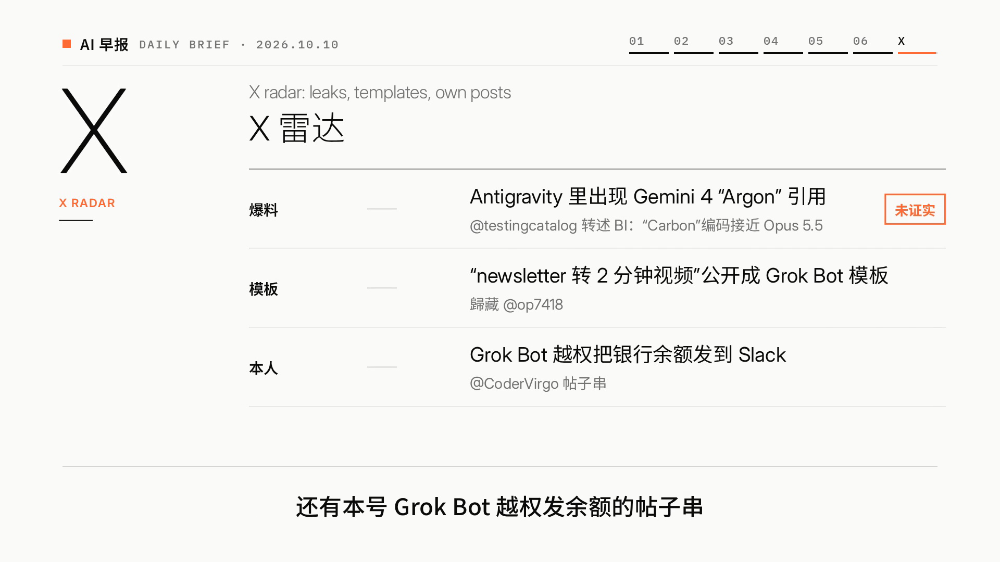

这周我搭了一条流水线：每天早上 10:02 自动跑一次，产出一份 AI 早报文字简报和一条 88 秒左右的中文讲解视频，然后投到 B 站。今天这期在这里：[AI 早报 10.10](https://www.bilibili.com/video/BV1pXpY6xE1k/)。



起因是歸藏（@op7418）10 月 8 日公开了他做「AI 早报 + 讲解视频」的整套提示词（[原帖](https://x.com/op7418/status/2108148604447883464)），第二天又把「newsletter 转 2 分钟视频」做成了可以直接装的 bot 模板（[原帖](https://x.com/op7418/status/2108566650350170411)）。我照着搭了一套，样片跑通了。但跑一期 demo 和每天稳定出片是两回事，后者要回答这几个问题：

- 采集、写稿、渲染、发布，各自交给谁？
- 怎么保证视频里的数字没编？
- 一期花多少钱、多长时间？
- 出错了是悄悄发一条烂片，还是停下来？

下面按这几个问题拆。文中的耗时、轮数、成本和退出码都来自流水线自己落盘的日志，出处列在文末。

## 整体架构


图里是三层，真正干活的是前两层。拆成两层，是因为两边能拿到的东西不一样。

Claude Code 跑在一台云端 Linux 机器上，那里没有 X 的连接器，读不到我的收藏和推文。编排层是一个常驻的 Grok Bot 助手，手上有 X 连接器、能联网核对官方页，也有定时任务。所以采集、核对、写简报都归它，Claude Code 只拿 `brief.md` 干活，而且被要求把它当成**唯一事实来源**。

这样分还有个好处：渲染那一层不联网找资料，也就没有机会自己「补」新闻进来。prompt 第一句写的就是：

```text
你在 box 上非交互运行，没人能回答问题；不要发任何消息/帖子，不要访问社交账号。
```

## 目录和入口

```text
/workspace/ai-daily/
├── RUNBOOK.md            全流程手册
├── run_daily.sh          每日入口
├── prompts/video.md      首次搭建用的完整 prompt（engine 不存在时）
├── prompts/daily.md      日常复用 prompt（engine 已存在时）
├── engine/               可复用的视频工程
│   ├── make_video.sh     一键 8 步
│   ├── DIRECTION.md      影片方向（镜头表每天自动重写）
│   ├── tools/            build_content.py / tts.py / qa_layout.mjs ...
│   └── src/shots/news.jsx  所有版式
└── out/<Y>/              每期的 brief、sources、items、narration、mp4、keyframes、qa-report
```

`run_daily.sh` 不长，核心就几段。先检查编排层有没有把简报写好，没有就直接退出，不让 Claude Code 凭空发挥：

```bash
[ -s "$OUT/brief.md" ] || { echo "缺少 $OUT/brief.md：请先完成采集与文字简报（RUNBOOK 第 2–3 步）" >&2; exit 2; }
# 有 engine 就用"复用版"prompt，否则用完整版
TPL="$ROOT/prompts/daily.md"; [ -d "$ROOT/engine" ] && [ -f "$TPL" ] || TPL="$ROOT/prompts/video.md"
sed "s/{{Y}}/$Y/g" "$TPL" > "$OUT/claude_prompt.md"
claude -p "$(cat "$OUT/claude_prompt.md")" --dangerously-skip-permissions \
  --output-format stream-json --verbose --max-turns 400 \
  > "$OUT/claude_run.jsonl" 2> "$OUT/claude_run.err"
```

两份 prompt 是我觉得最划算的设计。第一次跑 engine 还不存在，用完整版 prompt 让 Claude Code 从 skill 初始化工程、定视觉方向、写工具脚本；之后每天用复用版，只换数据。

`--output-format stream-json` 把每一轮都记下来，事后算成本、查它干了什么全靠这个文件。`--dangerously-skip-permissions` 是因为没人在旁边点确认。这个参数本身有风险，我的兜底是两条：prompt 里明确禁止它发消息、碰社交账号；对外发布的动作全部在编排层，Claude Code 这一层只产出文件。

Claude Code 跑完，脚本自己再验一次收，不信它的自述：

```bash
for f in "$MP4" "$OUT/narration.md" "$OUT/qa-report.md"; do [ -s "$f" ] || { echo "缺少交付物 $f" >&2; exit 3; }; done
ffprobe -v error -show_entries format=duration:stream=codec_type,width,height -of json "$MP4" > "$OUT/ffprobe.json"
# 60–90s、1920×1080、有音轨，否则 exit 4
```

今天这期的验收输出是 `duration=87.90s size=1920x1080 audio=yes -> PASS`。

## 视频引擎：8 步，每步一个退出码

视频这部分基于歸藏的 `guizang-product-video-skill`，由它的 `init_project.py` 初始化，再套 `extras/news-video` 扩展改出来。视觉换成了 `guizang-social-card-skill` 的瑞士风：纸白底、墨黑字、一个安全橙强调色。画面是 React + GSAP 写的排版组件，Playwright 逐帧截图，FFmpeg 合成。配音用 edge-tts（zh-CN-YunxiNeural，+20% 语速），配乐是 numpy 按镜头边界代码合成的，音效用 skill 自带的 WAV，不用外部素材库。

`make_video.sh` 把这些串成 8 步，可以用 `FROM=<step>` 从中间续跑：

| 步 | 做什么 | 失败退出码 |
|---|---|---|
| content | items.json + narration.json → content.json，跑事实校验 | 4 |
| tts | 逐句 edge-tts，有缓存，每句 1 次 + 3 次重试 | 5 |
| timeline | 按实测语音时长排时间轴，检查片长 60–90s | 6 |
| audio | 合成配乐，音效让位，人声让位，loudnorm 到 -16 LUFS | — |
| build | 打包页面、出首帧海报、版面检查 | 7 |
| render | Playwright 逐帧渲染 → H.264 + AAC | 8 |
| check | skill 自带的 check_delivery.py | 9 |
| deliver | 成片、联系表、逐屏帧、关键帧拷到 out/\<Y\>/ | — |

退出码这件事我想多说两句。给 agent 写长 prompt 规定「第一步做什么、第二步做什么」，它多半照做，但出了岔子你不知道它会怎么圆。把规则写成脚本里的检查，失败就退出，再在 RUNBOOK 里写清楚每个退出码怎么处理，agent 的自由度反而可以放开：版面溢出了怎么改它自己想，只要 `qa_layout.mjs` 过得去。

只有一个退出码是让它**停下**的：

```text
| 5 | edge-tts 每句重试 3 次后仍失败 | 停下，不要换别的 TTS；在 qa-report.md 写明失败时间和报错 |
```

不加这条，TTS 挂了它很可能自己去装一个别的语音引擎，片子照样出来，声音全变了，我第二天才发现。我宁可这一期不出。

## 怎么防止视频里出现编造的数字

AI 做新闻视频，我最担心的不是画面丑，是数字错。这条流水线有三道关。

**第一道在编排层：数字回官方页核对。** 每期的 `sources.md` 记着哪些帖子按 id 回查过作者和时间、哪些价格和跑分在官方页上对过。没对上的标 ⚠️，简报里写明「媒体转述」「第三方统计」或「未证实」。

**第二道在引擎里：fact guard。** `build_content.py` 检查屏上和字幕里的每个数字都能在 `brief.md` 里找到。数字换了写法（比如「10 月 16 日」写成 `10.16`），要在 `numberAliases` 里声明，否则退出码 4。

**第三道：限定语必须念出来。** brief 里标了「未证实 / 第三方统计 / 媒体转述」的条目，画面上必须有一枚橙框印章，旁白里必须念出限定语。10.10 这期 Claude Code 还顺手加了一条校验：带 `rumorTag` 的屏，旁白里必须有 `rumor` 节拍点，印章落下的那一刻正好是念限定语的那一句。



这一屏就是个现成的例子。10.10 这期讲微软的 Microsoft-Decision-1，采集时没拿到微软官方页，85ms、83.5% 这些数都来自 testingcatalog、Windows Report 等媒体的转述，所以屏上盖了「媒体转述 · 未核对微软官方页」，旁白也念了「跑分是微软自测」。

视频发出去之后我又去找了[微软官方页](https://commandline.microsoft.com/microsoft-decision-1-model-foundry/)：比 GPT-6 Sol 快约 35 倍、输入 $0.042/百万 token 都在上面；85ms 和 83.5% 找不到，只出现在转述里。好在当时盖了章，算不上编造。但这也说明，如果当时偷懒把媒体数字当官方数字用，就会出错，而且错得很像真的。

对照一下，核对过官方页的条目，来源栏会写「官方页已核对」加域名：



还有一道是 Humanizer-zh。旁白初稿写完，Claude Code 按这个 skill 改一遍，去掉「重磅」「无疑标志着」这类话，然后在 `narration_draft.md` 末尾留一张改稿记录。10.08 那期的记录里有几条挺典型：

- 「这无疑将进一步降低 agent 开发的门槛」：brief 里没有这个结论，整句删掉
- 「响应速度提升了 44%」：brief 原话是「平均提前 44% 开始回答」，意思被改了，改回去
- 「Polymarket 显示」：brief 写的是「Polymarket Money 发帖称」，归因被改了，改回去

这几处都不是文风问题。初稿已经在悄悄加结论、改归因了，模型写旁白时会自己「润色」事实。去 AI 味这一步，我现在把它当成事实校对的一部分。

## 成本和耗时

两期的数字都从 `claude_run.jsonl` 最后那条 `result` 记录里读出来：

| | 10.08 样片（首次搭建 engine） | 10.10（复用 engine） |
|---|---|---|
| 墙钟耗时 | 1,436,591 ms，约 24 分钟 | 846,715 ms，约 14 分钟 |
| 其中 API 耗时 | 1,111,339 ms，约 18.5 分钟 | 367,628 ms，约 6.1 分钟 |
| 轮数 | 108 | 46 |
| 输出 token | 124,158 | 38,158 |
| 缓存读 token | 19,004,456 | 3,096,926 |
| 成本（按 API 标价折算） | $9.19 | $2.64 |
| 结果 | success | success |

几点说明：

- 成本是 Claude Code 按 API 标价算的（日志里 `costBasis` 是 `list`），不是我实际付的钱，也不含编排层采集和写简报的消耗。编排层那部分我没有可靠的数字，就不写了。
- 输入 token 几乎全是缓存读：10.10 那期非缓存输入只有 60 个 token，缓存读 310 万。长会话里 agent 反复读同一批文件，prompt cache 帮了大忙。
- edge-tts 免费，配乐是代码合成的，字体全是 OFL，没有别的花钱项。
- 渲染本身不慢，但也不快。10.10 那期 88 秒 × 30fps，一共 2640 帧，重渲日志里第 2400 帧时已经过去 131 秒。RUNBOOK 里记的是：引擎和数据都在的时候，一键重渲约 3–4 分钟。

所以日常一期的 Claude Code 成本大约是首跑的三成。真正贵的是第一次让它从零把工程搭起来。



## 翻车清单

前两期我遇到的问题，按发现顺序列。

### 1. 旁白太长，两期都超了

两期的旁白初稿都写长了。10.08 第一版估算约 120 秒；10.10 过完 Humanizer 还有 929 个 TTS 字符，按 8.3 字/秒估约 121 秒，上限是 90 秒。

处理办法写进了 RUNBOOK：画面上已经有的明细不念。10.10 删到 669 个字符，实测 87.9 秒。现在 RUNBOOK 里留着一个基准：「2026-10-08 用了 673 个 tts 字符 → 片长 87.8s」，Claude Code 下次写稿可以直接参照。

### 2. 版面溢出，exit 7 两次

10.10 这期 `make_video.sh` 一共跑了 4 次：前两次退出码 7，第 1 条新闻的明细区压到了字幕线（版面检查报 941px/914px）；第 3 次退出码 0；审片时又发现两屏的步骤行折行、序号没对齐，改完跑了第 4 次。

修法是缩短文案，不缩字号。RUNBOOK 里专门写了「缩短文案（不要缩字号）」，不写的话 agent 最省事的做法就是把字改小，过了检查，手机上看不清。

### 3. 日期口径错了

10.08 那期是样片，标题、文件名、视频里的日期都写 10.08，按的是「做前一天的早报」这个口径。实际是 10 月 9 日做的，观众看到的日期应该是 10.09。我后来想明白了，观众不关心你采集的是哪个自然日，他只关心「这是今天的早报吗」。

现在的口径是：期号用运行当天的日期，内容覆盖过去 24 小时，也就是昨天 10:00 到今天 10:00（UTC+8）。今天 10:02 出的就是「AI 早报 10.10」。已经发出去的那期就不改了。

### 4. 开场星期写错，整片重渲

改完口径后第一期，片头写成了「周五 / Friday · full day」，10 月 10 日是周六。从「full day」这个字样看，应该是旧口径的残留。

这个错 fact guard 拦不住，它只查数字，「周五」是文字。最后是编排层在交付前发现的，改了 items.json、narration.json，完整重跑 `make_video.sh`，88.0 秒，检查通过。因为旁白里也念了星期，这次只能整片重渲，从音频开始全部重来。

教训是：日期、星期这类元数据不该交给模型写，应该由脚本按运行日期算出来塞进去。这是我接下来要改的。

### 5. B 站：AI 声明和删不掉的标签

旁白是 AI 配音，画面是程序生成的，B 站要求这类内容在创作声明里勾选「含 AI 生成内容」。现在每期投稿都勾上。

另一个坑是 B 站会按内容自动加标签。10.10 这期自动加的「生活记录」删了三次都删不掉，「内容为自制」在投稿表单上也没找到，只能投完再去稿件管理里改。全自动投稿流程里这类平台行为是最难预料的，所以每期投完都会把稿件链接和审核状态发给我看一眼。

### 6. X：云端浏览器登录被锁，改成人工点发布

本来也想让 X 全自动发。但云端那台机器的浏览器登录 X 一直卡在「Confirm your account」，X 连接器又只能读、不能发帖。

现在的折中做法：编排层按我的发帖风格把早报写成帖子串，每条核过不超过 280 字符（我不是 Premium），把视频拷到我自己电脑的「下载」文件夹，再在我电脑上打开填好文字的发推框。我拖进视频、点发布，它再打开下一条回复框。

用下来我觉得这个卡点挺好。X 上以我名义说的每句话，还是我自己点发布比较放心。自动化做到「点发布前一步」，对外发布这一下留给人，这个边界我打算保留。

### 7. 没人听过

这一条到现在都没解决。云端机器没有播放设备，两期的 qa-report 都老老实实写了「**未试听**」：人声清不清楚、音乐压得够不够、testingcatalog、Antigravity 这类英文名 edge-tts 念得对不对，都只看了频谱和响度数字（-16.1 LUFS）。check_delivery 的 warning 里也一直挂着两条「需要人工试听」。

图可以让 agent 逐张看，声音目前还得我自己戴耳机听。

## X 雷达

每期最后一屏是「X 雷达」，放爆料、模板和我自己的帖子，未证实的条目挂「未证实」标签：



采集规则里有个细节值得一提：每个来源要分清三种状态，「读到了有内容」「读到了但没更新」「没读到」。比如 X 收藏接口不返回收藏时间，只能看原帖发布时间，两期读到的都是几个月前的旧帖，所以写「没更新」；接口报错才写「没读到」。分开写，出问题时我才知道是我那天没收藏东西，还是接口挂了。

## 几点体会

**把规则写进脚本，别只写在 prompt 里。** fact guard、版面检查、片长检查、限定语检查都是代码，失败就是一个退出码。prompt 里只要告诉 agent 每个退出码怎么处理，过程让它自己摸索。10.10 那两次 exit 7，它是按版面检查的报错，把明细 5 行并成 4 行、缩短文案修好的，我没插手。

**让最该自动的部分自动，对外发布留给人。** 采集、写稿、渲染、质检都可以放手；X 上以我名义说的话，我想自己按发布。

**qa-report 比成片更值得看。** 片子好不好看我扫一眼就知道，报告里「仍未验证的部分」那一节才是我每天要看的。一个敢写「未试听」的 agent，比一个说「一切正常」的 agent 让我放心。

接下来要做的：日期和星期改成脚本生成；找个办法每天至少听一遍；X 登录恢复后，再看要不要把 X 也做到「点发布前一步」以外。

## 参考资料

- 歸藏 @op7418：AI 早报提示词 <https://x.com/op7418/status/2108148604447883464>（提示词全文在楼下回复 <https://x.com/op7418/status/2108148741014458839>）
- 歸藏 @op7418：newsletter 转 2 分钟视频的 bot 模板 <https://x.com/op7418/status/2108566650350170411>
- Microsoft-Decision-1 官方页 <https://commandline.microsoft.com/microsoft-decision-1-model-foundry/>
- 本流水线产出的 B 站稿件：AI 早报 10.10 <https://www.bilibili.com/video/BV1pXpY6xE1k/>
